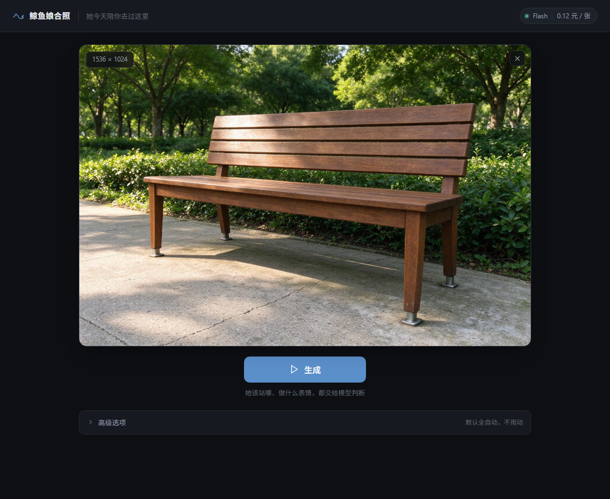
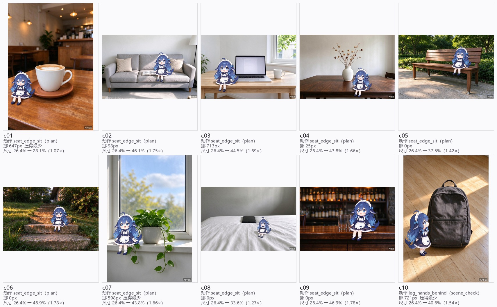
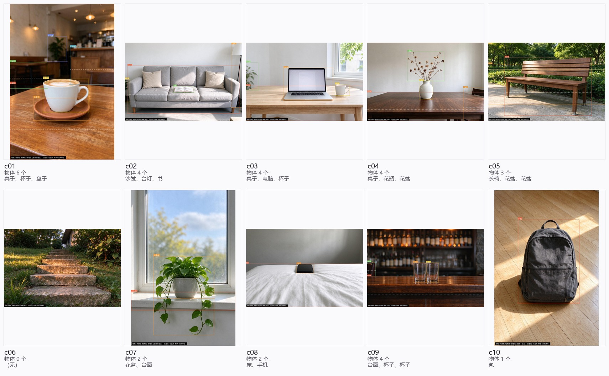
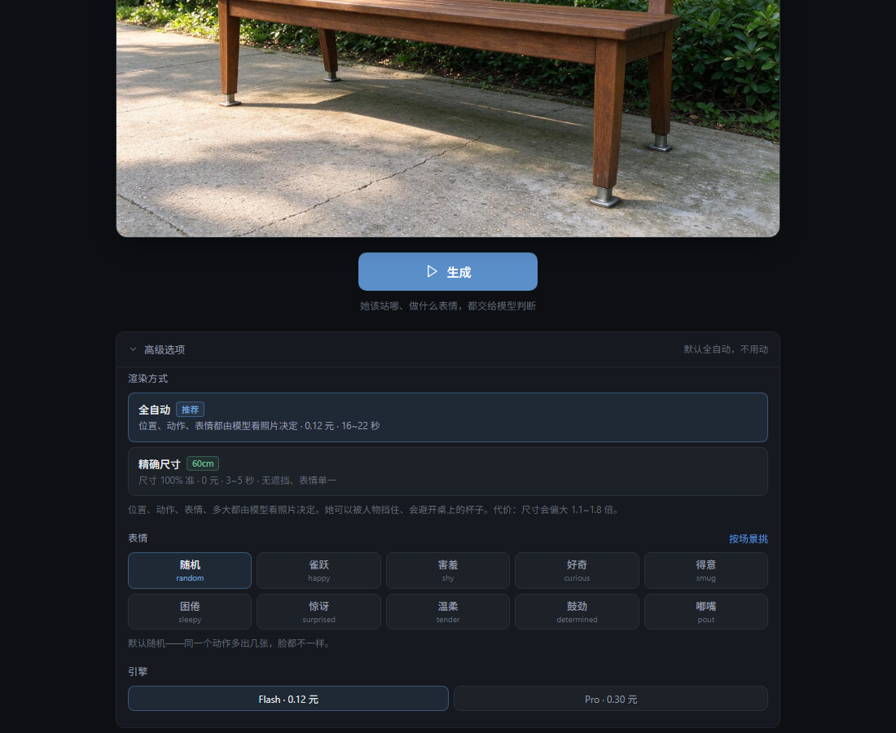

# 鲸鱼娘合照 · whale-companion

> 上传一张你自己的照片，让一个 **60cm 高的 Q 版角色**出现在里面。
> 位置、动作、表情由 AI 看着照片决定，你只需要点一次「生成」。



这不是又一个"文生图"玩具。它解决的是一个很具体的问题：

**现有的 AI 出图工具让你"生成一张新图"，而你想要的其实是"我的照片里多一个人"。**

前者要的是想象力，后者要的是**在场感**。所以这个项目的全部技术选择都围绕一件事——
**怎么把原照片里的一切（人、光、家具、背景）保住，只往里加一个人，而且加得进去。**

---

## 目录

- [两条路线，一个取舍](#两条路线一个取舍)
- [效果](#效果)
- [快速开始](#快速开始)
- [配置](#配置)
- [HTTP API](#http-api)
- [它是怎么做到的](#它是怎么做到的)
- [已知限制（先读这段再决定用不用）](#已知限制先读这段再决定用不用)
- [换成你自己的角色](#换成你自己的角色)
- [成本与耗时](#成本与耗时)
- [合规](#合规)
- [目录结构](#目录结构)
- [文档](#文档)
- [License](#license)

---

## 两条路线，一个取舍

这个项目最重要的结论是：**"精确尺寸" 和 "真实融合" 在当前的模型能力下不可兼得。**
所以代码里同时保留了两条路线，让用户自己选。

| | `auto` 全自动（引导生成） | `sprite` 精确尺寸（立绘合成） |
|---|---|---|
| 成本 | 0.12 元 / 张（Flash） | **0 元** |
| 耗时 | 16~22 秒 | **3~5 秒** |
| 尺寸 | 系统性偏大 1.13~1.78 倍，**做不到 60cm** | **精确**（程序 resize，要多少给多少） |
| 遮挡关系 | 能被家具挡住，有前后层次 | 永远贴在最前，**不可能被挡** |
| 表情 | 9 种，可随机 / 按场景 | 无（立绘自带表情） |
| 光影 | 跟着原图重绘，基本能接上 | 程序近似匹配，暗光容易脱节 |
| 可复现 | 差，同一张图跑三次可能三个结果 | **完全确定** |

默认走 `auto`——因为大多数人要的是"这张图好看"，不是"她正好 60.0 厘米"。
但要批量、要精确、要抗并发，就该切 `sprite`。

**为什么精确尺寸做不到？** 生图模型有一条隐性先验：画面里的人物低于约 26~30% 高度时，
它会自动把她放大到"看起来合理"的尺寸。60cm / 175cm ≈ 34%，在全身照里勉强够，
半身照和特写里必然被放大。这是模型先验，不是调参能解决的。
完整实测数据见 [`docs/13`](docs/13-引导生成路线的缺陷清单.md)。

---

## 效果

10 张不同家具的空场景，自动避让桌上的杯子、书本、背包，各自挑合适的动作：



它看到的不是"一张图"，而是一个带接地线的简易 2.5D 场景——
每个物体有外接框、有"越靠下越近"的深度，她要坐的面上不能有东西：



高级选项里可以改渲染路线、指定表情、指定动作：



---

## 快速开始

**前置**：Python 3.12+，一个[火山引擎方舟](https://console.volcengine.com/ark)账号（图像生成 + 视觉模型）。

```bash
git clone https://github.com/Yhmx6/whale-companion.git
cd whale-companion

python -m venv .venv
source .venv/bin/activate          # Windows: .venv\Scripts\activate
pip install -r requirements.txt

cp .env.example .env               # 打开 .env，填 ARK_API_KEY
python -m app.server
```

打开 <http://127.0.0.1:8848> ，拖一张照片进去，点「生成」。

没有密钥也能启动——页面能打开、能传图，只有真正点生成时才会报错。

### Docker

```bash
docker compose up --build
# 或者
docker build -t whale-companion .
docker run -p 8848:8848 -e ARK_API_KEY=你的密钥 whale-companion
```

容器里装了中文字体（`fonts-wqy-microhei`），否则导出图的 AI 标识会渲染成方块。

### 离线自检（第一个不花钱、不联网、0.1 秒）

```bash
python experiments/step25_avoid_cases.py    # 避让逻辑 8 条回归，0 成本
python experiments/step29_routes.py         # 路线分派 11 条回归，0 成本
```

改完 `s3/scene3d.py` 跑第一个，改完 `app/pipeline.py` 的路线分派跑第二个。
比重新生成一张图快两个数量级——避让那 8 条用例，就是 p04「她坐在咖啡杯里」那次事故的回放。

表情挑选要看 VLM 的判断，得花几分钱（只解析、不生成图）：

```bash
python experiments/step27_mood_pick.py      # 10 张约 0.02 元
```

其余脚本见 [`experiments/README.md`](experiments/README.md)。

---

## 配置

全部走环境变量（或同目录的 `.env`）：

| 变量 | 默认值 | 说明 |
|---|---|---|
| `ARK_API_KEY` | 空 | **必填**。方舟 API Key |
| `ARK_BASE_URL` | `https://ark.cn-beijing.volces.com/api/v3` | 接口地址 |
| `ARK_IMAGE_MODEL` | `doubao-seedream-5-0-flash-260915` | 生图模型。日期后缀必须和账号里开通的一致，否则报 model not found |
| `ARK_VLM_MODEL` | `doubao-seed-2-1-lite-260915` | 视觉模型，用来读照片 |
| `HOST` | `127.0.0.1` | 监听地址。要局域网访问改 `0.0.0.0` |
| `PORT` | `8848` | 端口 |
| `GUIDE_SIZE_BIAS` | `1.0` | 引导图尺寸修正系数，>1 画得更大。调参用，一般不用动 |

换 Pro 模型（质量更好、更贵）：`ARK_IMAGE_MODEL=doubao-seedream-5-0-pro-260628`。

---

## HTTP API

服务是个单文件 `ThreadingHTTPServer`，没有框架依赖。

### `POST /api/generate`

提交任务，立刻返回 job id（**生成是异步的**，后续轮询）。

```json
{
  "image": "data:image/jpeg;base64,...",
  "route": "auto",
  "mood": "random",
  "engine": "doubao-seedream-5-0-flash-260915",
  "character": "chibi"
}
```

| 字段 | 必填 | 说明 |
|---|---|---|
| `image` | 是 | data URI 或裸 base64 |
| `route` | 否 | `auto`（默认，一键出图）/ `sprite`（精确尺寸）/ `guided`（同 auto）/ `planned`（对照组） |
| `mood` | 否 | `random`（默认）/ `auto`（按场景）/ 具体 id，见 `/api/moods` |
| `action` | 否 | 指定动作 id，`sprite` 路线**必填**，`auto` 路线留空由模型挑 |
| `engine` | 否 | 覆盖 `ARK_IMAGE_MODEL` |
| `character` | 否 | 角色 id，默认 `chibi` |
| `box` / `surface` / `light` / `mode` | 否 | 老拖框流程用的参数，`auto` 路线不需要 |

```bash
curl -s http://127.0.0.1:8848/api/generate \
  -H 'Content-Type: application/json' \
  -d "{\"image\":\"$(base64 -w0 photo.jpg | sed 's/^/data:image\/jpeg;base64,/')\",\"route\":\"auto\"}"
# => {"job_id":"a1b2c3d4e5f6"}
```

### `GET /api/job/<id>`

轮询任务。`status` 依次是 `queued → running → done`（或 `error`），
`stage` 是给人看的中文阶段名，`pct` 是 0~100。

`done` 时返回 `files`（产物相对路径）和 `meta`——**`meta` 是排查问题的关键**：
里面有 VLM 解析结果、挑中的动作与理由、表情、尺寸倍率、避让挪了多少像素、warnings。

### 其它

| 路径 | 用途 |
|---|---|
| `GET /api/actions` | 动作库（默认启用的 + 全部） |
| `GET /api/moods` | 表情清单 |
| `GET /api/characters` | 角色清单 |
| `GET /api/health` | 健康检查，返回当前模型名 |
| `GET /files/<job>/<name>` | 取产物图 |
| `GET /assets/<name>` | 取立绘（仅 `assets/sprites`，挡掉了路径穿越） |

---

## 它是怎么做到的

### 引导生成（`route="auto"`）分成三段

```
照片 ──VLM──> 规划（构图/光线/家具/可坐面 + 挑动作挑表情）
                  │
                  ├──程序──> 算尺寸和落点（60cm → 像素）──> 画引导图
                  │
                  └────────> 生图模型：拿引导图 + 提示词，只负责"融合"
```

关键设计：**尺寸和位置不交给模型**。

模型的强项是融合（光影、边缘、遮挡关系），弱项是数数和测量——让它"画一个 60cm 高的人"，
它会给你一个"看起来合理"的人。所以位置由程序算好、画成引导图喂进去，模型只做它擅长的那部分。

### 简易 2.5D 场景

从照片里解析出物体框，横向纵向用外接框，**深度只用一条接地线**（`base_y` 越大越近）。
够用，而且比真 3D 便宜三个数量级。

避让靠四道筛子（`s3/scene3d.py::footprint_conflicts`）：

1. `person` 不算障碍——那是她自己
2. 横跨画面 > 85% 的当背景面，跳过
3. 她坐在某个面上时，那个家具本身不算障碍
4. **不是家具的东西（杯子、书、背包）无条件躲**，不看大小

第 4 条是踩坑踩出来的：一开始给"小物件"设了 35% 尺寸门槛，
结果一张特写里杯子和盘子各占 44% / 54%，被当成"大家具"放过了，她就坐进了咖啡杯里。

### 表情

9 个表情（happy / shy / curious / smug / sleepy / tender / surprised / determined / pout）。
`face` 字段**只写五官动作，不写情绪词**——写"开心"模型给你一个笑脸贴图，
写"眼睛弯成月牙、嘴角上扬约 15 度"才有具体落点。

三档：`random`（默认，随机）/ `auto`（按场景亮度、色温、家具语义打分挑）/ 指定 id。

背视角动作（`face_visible=False`）会跳过整套表情逻辑——看不见脸，写表情只会干扰模型。

---

## 已知限制（先读这段再决定用不用）

诚实清单，完整版见 [`docs/13`](docs/13-引导生成路线的缺陷清单.md)：

| # | 限制 | 影响 |
|---|---|---|
| 1 | **尺寸做不到 60cm**，系统性偏大 1.13~1.78 倍 | 要精确就切 `sprite` |
| 2 | **可复现性差**，同一张图跑三次可能三个结果 | 没有 seed 控制 |
| 3 | 成本 0.12 元/张、16~22 秒 | `sprite` 是 0 元 / 3 秒 |
| 4 | 接触阴影经常很淡甚至没有 | 模型自己画的，控制不了 |
| 5 | 暗光/逆光容易脱节 | 没有重打光 |
| 6 | 表情画得准不准因表情而异，`smug` 最差 | 提示词还在调 |
| 7 | 避让只挪横向，**不检查支撑面还在不在她身下** | 极端构图会坐空 |
| 8 | 2.5D 场景是矩形占位，不是真实轮廓 | 斜放的桌子会误判 |
| 9 | API 不支持 mask 局部重绘 | 只能整图重绘 |
| 10 | 一次只出一张，没有候选 | 要 N 张就调 N 次 |
| 11 | 任务状态只在内存里，刷新即丢 | 生产要落盘 |
| 12 | 阈值都是 10~20 张图上定的，换素材可能要重标 | 没有金标准集 |

还有一条环境限制：**立绘的背视角如果姿态和照片里的人物太像，会被模型合并**——
照片里那个人就没了。这类动作已经降到 C 档（默认不启用）。

---

## 换成你自己的角色

角色是一等公民，不写死在代码里。

1. 把设定图放进去：

```
assets/characters/<你的角色id>/
├── front.png     正面
├── side.png      侧面
├── face.png      脸部特写
└── sprites/      生成的立绘缓存（自动写入）
```

2. 在 `s3/characters.py` 注册：

```python
MY_CHAR = Character(
    id="my_char",
    name="我的角色",
    refs=(_ref("characters", "my_char", "front.png"),
          _ref("characters", "my_char", "side.png")),
    identity="外形描述，越具体越好",
    body="体型 / 头身比",
    height_cm=60.0,        # 真实身高，产品的硬规定
    scale=60.0 / REF_PERSON_CM,
)
```

3. 生成立绘：`python experiments/exp_sprite.py`（或直接在网页「精确尺寸」路线里选动作）。

**立绘提示词有一条硬性要求：不画依附物。**
早期版本里 desc 写"手扶栏杆"，模型就真给她画了一根栏杆带进产物——
现在这类动作改成不依赖具体物体的姿态（`s3/sprite.py::build_sprite_prompt`）。

---

## 成本与耗时

| 项目 | Flash | Pro |
|---|---|---|
| 生图 | 0.12 元 / 张 | 0.30 元 / 张 |
| 视觉解析（VLM） | ≈ 0.002 元 / 张 | 同上 |
| 耗时 | 16~22 秒 | 25~40 秒 |
| `sprite` 路线 | **0 元 / 3~5 秒** | 同左（本地合成，不走 API） |

一次点击 = 1 次 VLM + 1 次生图（`sprite` 路线只有 1 次立绘生成，之后复用缓存）。

---

## 合规

**AI 生成内容必须显式标识。** 国标 GB 45438-2025 要求标识文字高度不低于画面最短边的 5%
（早期版本按 2.8% 做的，**不达标**，已修）。

实现见 `s3/beautify.py::add_ai_label()`：用 `getbbox` 实测渲染后的字高，
不足就加大字号重新排，最多 8 轮。导出图右下角固定位置。

另外两条只能提醒、没法用代码保证：

- 上传**他人**照片需取得授权；
- 生成内容用于商业传播前，请自行确认当地法规与平台规则。

---

## 目录结构

```
.
├── app/
│   ├── server.py           HTTP 服务（标准库，无框架）
│   ├── pipeline.py         全部流程编排：路线分派、尺寸、合成、导出
│   └── static/             前端（原生 JS，无构建步骤）
├── s3/                     纯逻辑层，不依赖 HTTP
│   ├── actions.py          26 个动作模板（含 3 个背视角）
│   ├── moods.py            9 个表情 + 场景收窄打分
│   ├── scene3d.py          2.5D 场景、碰撞避让、可视化
│   ├── plan.py             VLM 规划器（定位置/动作/表情）
│   ├── measure.py          逐像素 diff 测实际尺寸
│   ├── sprite.py           立绘生成提示词
│   ├── compose.py          立绘合成（缩放/接地/阴影/重打光）
│   ├── beautify.py         AI 标识
│   └── characters.py       角色注册表
├── api/ark.py              方舟客户端（urllib，零第三方依赖）
├── experiments/            31 个验证脚本，按 step 编号对应 docs
├── tools/                  辅助工具（界面自检、素材预处理）
├── assets/
│   ├── characters/         角色设定图
│   ├── sprites/            立绘缓存
│   ├── scenes/             测试场景（**全部 AI 生成**）
│   └── refs/               角色三视图裁切
├── docs/                   13 篇设计与实测文档
└── screenshots/
```

### 这个仓库里有什么、没有什么

- **有**：完整可运行的服务、纯逻辑层、26 个动作、9 个表情、13 篇文档、31 个验证脚本。
- **有**：测试场景全部是 AI 生成的（`experiments/step23`、`step30` 可复现），没有真人照片。
- **没有**：API 密钥（`.env` 在 `.gitignore` 里，只有 `.env.example`）。
- **没有**：任何个人照片。原作者开发时用的真实照片已全部移除，早期依赖它们的
  6 个实验脚本（`step10`~`step15`）也一并删掉了——它们在 `docs` 里的结论保留。

---

## 文档

按阅读顺序：

| 文档 | 内容 |
|---|---|
| [01 可行性评估](docs/01-可行性评估与技术方案-v0.1.md) | 技术路线是怎么选出来的 |
| [02 PRD](docs/02-PRD-v0.1.md) | 产品定义与用户诉求 |
| [03 竞品与开源调研](docs/03-竞品与开源方案调研-v0.1.md) | 市面上的方案 |
| [04 竞品深度调研](docs/04-竞品深度调研-v0.1.md) | 拆到算法层 |
| [05 开源方案核实](docs/05-开源方案核实报告-v0.1.md) | 哪些能用、哪些是吹的 |
| [06 管线设计与失败形态映射](docs/06-管线设计与失败形态映射-v0.1.md) | 每种失败长什么样、对应哪一层 |
| [07 待实测登记表](docs/07-待实测登记表与实现层硬约束-v0.1.md) | 实现层的硬约束 |
| [08 贴贴动作模板清单](docs/08-贴贴动作模板清单-v0.1.md) | 26 个动作的来历 |
| [09 手部问题解决方案](docs/09-手部问题解决方案调研-v0.1.md) | 手指为什么画不好 |
| [10 尺度与定位的根因修复](docs/10-尺度与定位的根因修复-v0.1.md) | 尺寸为什么会错 3 倍 |
| [11 场景路由与锚点体系](docs/11-场景路由与锚点体系-v0.1.md) | **最厚的一篇，核心设计** |
| [12 项目进展与问题清单](docs/12-项目进展与问题清单-v0.1.md) | 17 个问题的现状 |
| [13 引导生成路线的缺陷清单](docs/13-引导生成路线的缺陷清单.md) | **要上线先读这篇** |

---

## License

MIT。角色形象（`assets/characters/`、`assets/refs/`）来自项目作者，随仓库一同以 MIT 授权；
如果你要商用，建议换成自己的角色设定图。

---

<sub>这个项目是一个原型，代码里保留了大量"为什么这么做"的注释——包括走错的路。
如果你也在做类似的事，那些注释可能比代码本身有用。</sub>
